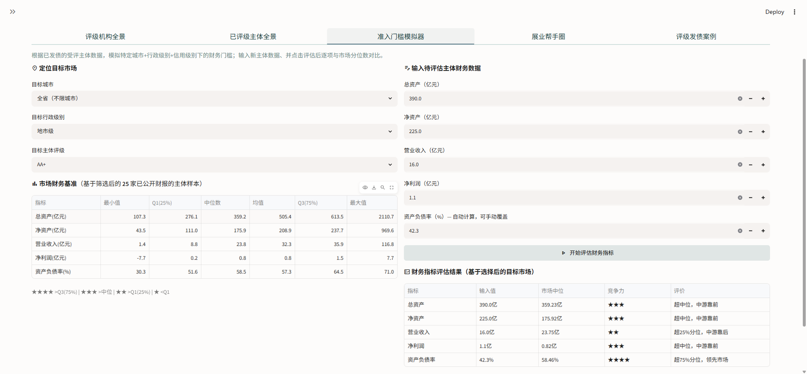

# 区域信用评级展业引擎

> **Regional Credit Rating BD Platform** — 基于轻量湖仓架构的信评展业分析平台

面向信用评级机构的区域展业分析平台。基于 Wind 城投债数据与地方财力数据，平台覆盖评级机构全景、已评级主体全景、准入门槛模拟器、展业帮手圈、评级发债案例（含 HTML 导出）五大核心分析模块，实现从底层数据到展业决策的端到端交付。

**An end-to-end analytics solution for credit rating agencies built on a modern Lakehouse architecture (Parquet + DuckDB). By standardizing and modeling LGFV bond and local fiscal data from Wind, the platform delivers five core business modules: Credit Rating Landscape, Rated Entity Landscape, Financial Admission Simulator, Partner Network, and Rating Case Studies with HTML export functionality for generating client-ready portable reports. It bridges the gap between raw financial data and strategic business development decisions.**

---

## 目录

- [项目定位](#项目定位)
- [项目预览](#项目预览)
- [技术架构](#技术架构)
- [项目结构](#项目结构)
- [快速开始](#快速开始)
- [数据管理与版本控制](#数据管理与版本控制)
- [数据质量检查(DQC)](#数据质量检查dqc)
- [DuckDB SQL 视图](#duckdb-sql-视图)
- [交付方案说明](#交付方案说明)

---

## 项目定位

本项目是面向信评机构的轻量湖仓分析平台，基于真实金融业务场景构建，为信评机构提供数据驱动的展业支持。

以 Parquet 数据湖 + DuckDB 服务层为轻量湖仓数据底座，应用层由 pandas 承担动态透视、复杂集合运算、明细筛选与降级兜底。以 Streamlit 交付评级机构全景、已评级主体全景、准入门槛模拟器、展业帮手圈、评级发债案例五大分析模块。

该平台将分散的 Wind 债券数据，以及来自财汇数据库和统计公报的地方财力数据，转化为标准化、版本化、可多端消费的数据资产，贯穿“竞对博弈、区域研判、券商匹配、准入模拟与案例展示”五大核心场景，同时覆盖市场人员、分析师与管理层的差异化需求。

| 用户群体 | 核心需求                                                                                                 | 对应功能板块                                                           |
| -------- | -------------------------------------------------------------------------------------------------------- | ---------------------------------------------------------------------- |
| 市场人员 | 快速研判区域评级现状、识别竞对薄弱区域与展业突破口、锁定合作券商、评估客户关键指标差距、展示机构成功案例 | 评级机构全景、已评级主体全景、展业帮手圈、准入门槛模拟器、评级发债案例 |
| 分析师   | 调阅区域已评级主体分布与明细、开展可比主体财务指标对标                                                   | 已评级主体全景、准入门槛模拟器                                         |
| 管理层   | 跟踪各省份市场占有率变动、评估竞争对手态势，为区域资源配置提供依据                                       | 评级机构全景                                                           |

---

## 项目预览

在线预览：[credit-bd-plat.streamlit.app](https://credit-bd-plat.streamlit.app/)

看板截图：

评级机构全景


<details>
<summary>点击展开查看所有 Tab 截图</summary>

**已评级主体全景**


**准入门槛模拟器**



**展业帮手圈**


**评级发债案例**


**导出html报告示例**


</details>

---

## 技术架构

整体采用“Parquet + DuckDB + pandas”的混合架构，以 Parquet + DuckDB 为轻量湖仓数据底座，应用层以 pandas 承担动态透视、复杂集合运算、明细筛选与降级兜底。交付物包括：① Streamlit 决策看板，供业务人员、分析师、管理者直接使用；② 数据底座（`.duckdb` 视图 + Parquet 数据湖），供 BI 与后续应用复用。

### 总体架构

```
原始层 (Raw)
  └── Excel 文件，原封不动保留，作为数据证据
       data/raw/bond/全国城投债数据_WIND截止20230216.xlsx
       data/raw/fiscal/2021年四川省财力.xlsx ...
            │
            │  scripts/build_warehouse.py（ETL，一次性运行）
            │  ① pd.read_excel
            │  ② 列名归一化 + DQC 检查
            │  ③ df.to_parquet
            ▼
标准层 (Data Lake · Parquet)
  └── 列式存储，列名已归一化，DQC 已通过，历史快照永久保留
       data/warehouse/bond/bond_20230216.parquet      (债券数据)
       data/warehouse/fiscal/四川省_2021.parquet   ...（财力数据）
            │
            │  ④ CREATE OR REPLACE VIEW（由 models/ 下的 .sql 文件定义）
            ▼
服务层 (Serving · DuckDB)
  └── 只存 SQL 视图定义，不存数据，体积极小
       data/serving/credit_indicators.duckdb        (268 KB)
       data/serving/active_version.json
            │
            ├──► 应用层（Streamlit 页面 + pandas 计算）
            └──► Tableau / Power BI / DBeaver（通过 ODBC/JDBC 接入）
```

### 核心设计：轻量湖仓与混合架构

项目采用 Parquet + DuckDB 轻量湖仓数据底座，存储与计算解耦——Parquet 只存数据，DuckDB 只存 SQL 视图逻辑，二者可独立演进。客户的 IT 团队可以单独升级分析逻辑而不影响已有数据资产，降低维护成本。

- **数据可移植性**：`.parquet`文件 是清洗后高性能、标准化的中间层数据资产，具有高拓展性，可被 Spark、Java、R、云平台直接消费。客户未来迁移至 Spark 或云平台时，无需重新清洗数据，保护数据资产的长期价值。
- **资产化交付**：沉淀的 `.duckdb` 资产既支撑 Streamlit 前端，也可通过官方 ODBC/JDBC 驱动供 Tableau、Power BI、DBeaver 等 BI 工具查询同一套 SQL 视图，并为后续 AI Agent / Text-to-SQL 场景预留统一 SQL 访问层。固定口径指标一次建模、多端复用；动态透视、地图渲染、筛选后的伙伴圈等应用层逻辑，需在 BI 侧基于明细重建。

项目采用混合架构，在不同业务场景中采取了差异化的引擎使用策略，不是每个 Tab 都有两套等价的引擎实现：

* **Parquet（底层存储）** ：列式存储，体积较 Excel 缩小约 72%，实测读取比 Excel 快约 62–769 倍（DuckDB/pandas 两条路径，详见 benchmark/）。以一次性 ETL 替代运行时 Excel 解析，打破 IO 瓶颈，是实现数据层分析提速（首次分析完整数据层从约 4.1s 降至 0.70s，约 5.8 倍）的核心基础。
* **DuckDB（查询引擎）** ：嵌入式 OLAP，无需服务器；直接扫描 Parquet；负责可下推的高效过滤与聚合、固定 SQL 视图、服务层支撑及外部 BI 数据资产。
* **pandas（灵活计算）** ：负责动态透视、复杂集合运算等不适合固化为静态 SQL 的场景，并在必要时提供降级兜底。

三者不是互斥分层：同一个 Tab 可能先用 DuckDB 取数，再由 pandas 做动态透视或筛选。例如 Tab 0 竞争格局热力矩阵和 Tab 4 案例筛选始终由 pandas 完成；Tab 1 的 DuckDB 负责按省取数，城市/级别/评级筛选在 pandas；Tab 3 默认全部城市/级别走 DuckDB，有筛选时走 pandas。

#### 混合架构下各 Tab 实际运行路径

| Tab             | 功能模块            | DuckDB 角色                               | pandas 角色                                                     | 备注                                                                 |
| --------------- | ------------------- | ----------------------------------------- | --------------------------------------------------------------- | -------------------------------------------------------------------- |
| **全局**  | 省份 KPI            | `v_province_kpi`                        | 兜底计算                                                        | /                                                                    |
| **Tab 0** | 评级机构排名表      | `v_agency_market_share`                 | `mart_agency_stats()` 兜底                                    | /                                                                    |
| **Tab 0** | 饼图 / 柱状图       | 从 `v_agency_market_share` 派生         | 从排名表派生                                                    | /                                                                    |
| **Tab 0** | 竞争热力矩阵（4维） | `v_bond` 明细（经 `df_sc`）+ 机构名单 | `mart_competition_matrix()`，唯一计算路径                     | 按城市/行政级别/评级/财力段四选一的动态透视不适合固化为静态 SQL 视图 |
| **Tab 1** | 主体地图 / 名单表   | `v_issuer_profile` 按省取数             | 城市/级别/评级筛选 + 地图构建；兜底 `int_build_issuer_view()` | 筛选与 Plotly 地图在 pandas/UI 层完成                                |
| **Tab 2** | 准入门槛分位数      | `int_v_issuer_enriched`（内联聚合）     | `mart_financial_bench()` 兜底                                 | `v_financial_bench` 为固定组合视图，供 BI / 测试                   |
| **Tab 3** | 展业帮手圈          | 默认全部城市/级别走 `v_partner_network` | 有城市/级别筛选时走 `mart_partner_network()`；同时是兜底路径  | 筛选场景没有 DuckDB 等价视图                                         |
| **Tab 4** | 发债案例明细        | `v_bond` 全量明细（经 `df_sc`）       | 筛选 `df_sc` + HTML 导出，唯一计算路径                        | 应用内不生成专用 SQL 视图                                            |

> **说明**：
> （1）`mart_competition_matrix()` 的动态透视（城市 / 行政级别 / 评级 / 财力段）需要在运行时确定列结构，不适合固化为静态 SQL 视图，因此该模块始终使用 pandas 计算，DuckDB 仅提供原始数据。
> （2）准入门槛模拟器需要“任意维度通配 + 实时聚合”，而分位数不可加总。`v_financial_bench` = 给 BI 的“固定组合点查”预聚合宽表；`int_v_issuer_enriched` 内联聚合 = 给模拟器的“任意组合（含通配）实时算”。两者粒度、用途不同。
> （3）表中“唯一路径”表示该功能没有 DuckDB 等价实现，不应在一致性脚本中强行对比。

#### 混合架构下的兜底设计

DuckDB 主路径与 pandas 兜底路径由 `app/main.py` 中的 `_using_duckdb` 开关统一控制：

```python
# active_version.json 由 scripts/build_warehouse.py 维护
_using_duckdb = DB_PATH.exists() and bool(_active_snap)
```

判据之所以成立，是因为 `build_warehouse.py` 先注册并验证 `v_bond` / `v_fiscal` / `v_issuer_profile`，成功后才写 `active_version.json`。因此版本号非空即代表视图已建好可用；文件缺失或版本号为空时，应用整体降级到 pandas 路径。`run_analysis()` 据此选择数据来源：

```python
if _using_duckdb:
    # 主路径：DuckDB SQL 视图（视图查询，毫秒级）
    agencies = query_duckdb("SELECT * FROM v_agency_market_share WHERE ...")
else:
    # 兜底路径：pandas 函数（需读 Excel，秒级）
    agencies = mart_agency_stats(df_prov)
```

---

## 项目结构

```
.
├── app/
│   ├── main.py                  # Streamlit 应用入口（UI 层）
│   ├── main_stcloud.py          # Streamlit Cloud 入口：首次启动自动构建仓库后运行 main.py
│   └── config.py                # DQC 规则配置（阈值、必填字段）
│
├── scripts/
│   ├── build_warehouse.py       # ETL + SQL 加载器，Excel→Parquet→DuckDB 视图
│   └── compare_engines_test.py  # 降级一致性验证（Excel+pandas vs Parquet+DuckDB）
│
├── benchmark/                   # 性能基准测试套件（bench1-4 + 端到端补充）
│   ├── README.md                # 测试方法、口径与复现方式
│   ├── report.md                # 实测汇总报告（随仓库提交）
│   ├── run_all.py               # 一键运行并生成 report.md
│   ├── common.py                # 环境采集、计时统计、只读 DuckDB 连接
│   ├── bench1_parquet_vs_excel.py       # 文件格式读取对比
│   ├── bench2_pandas_vs_duckdb.py       # 纯计算引擎对比
│   ├── bench3_old_vs_new_flow.py        # 单查询新旧流程对比
│   ├── bench4_province_switch.py        # 省份切换响应
│   ├── measure_cold_start.py            # 全应用冷启动
│   ├── measure_end_to_end.py            # 端到端补充测量
│   ├── measure_warm_analysis.py         # 热分析数据层测量
│   └── results/                 # 可再生的测试产物（已 gitignore）
│
├── models/                      # 数据建模层（参考 dbt 分层思维）
│   ├── staging/
│   │   ├── stg_data.py          # 原始数据读取、列名归一化、DQC
│   │   ├── stg_v_bond.sql       # v_bond 视图定义（含 Parquet 路径占位符）
│   │   └── stg_v_fiscal.sql     # v_fiscal 视图定义（含 Parquet 路径占位符）
│   │
│   ├── intermediate/
│   │   ├── int_data.py                  # 多表关联、主体视图构建、DQC
│   │   └── int_v_issuer_enriched.sql    # 核心中间层：主体去重 + 财力 JOIN + 财力分段
│   │
│   └── marts/
│       ├── mart_credit_indicators.py        # pandas 计算/兜底聚合函数
│       ├── mart_v_province_kpi.sql          # 省份 KPI 汇总（7 个指标列）
│       ├── mart_v_issuer_profile.sql        # 去重主体视图（含财力字段）
│       ├── mart_v_agency_market_share.sql   # 评级机构省内市场份额
│       ├── mart_v_agency_competitive_landscape.sql  # 评级机构竞争格局宽表
│       ├── mart_v_city_credit_overview.sql  # 城市已评级主体概览
│       ├── mart_v_financial_bench.sql       # 财务指标准入分位数（全组合宽表）
│       ├── mart_v_underwriter_stats.sql     # 主承销商排名（全维度宽表）
│       └── mart_v_partner_network.sql          # 展业伙伴网络（共同客户分析）
│
├── data/
│   ├── raw/                     # 【原始层】债券 Excel 及 各省财力 Excel
│   │   ├── bond/
│   │   │    ├── 全国城投债数据_WIND截止20230216.xlsx
│   │   │    └── 全国城投债数据_WIND截止20230520(虚拟).xlsx
│   │   └── fiscal/
│   │        ├── 2021年四川省财力.xlsx
│   │        └── ...（共 13 省）
│   │
│   ├── warehouse/                      # 【标准层】Parquet 数据湖
│   │   ├── bond/
│   │   │   ├── bond_20230216.parquet   #  由 build_warehouse.py 运行后生成
│   │   │   └── bond_20230520.parquet   #  由 build_warehouse.py 运行后生成
│   │   └── fiscal/
│   │       ├── 四川省_2021.parquet      #  由 build_warehouse.py 运行后生成
│   │       └── ...
│   └── serving/                        # 【服务层】DuckDB 文件
│       ├── credit_indicators.duckdb    #  由 build_warehouse.py 运行后生成
│       └── active_version.json         #  由 build_warehouse.py 运行后生成
│
│
├── .gitignore                   # Git忽略规则
├── pyproject.toml               # 包安装配置（pip install -e .）
├── requirements.txt             # 部署依赖清单
└── README.md
```

---

## 快速开始

### 环境要求

- Python 3.11+
- 操作系统：Windows / macOS / Linux

### 安装

```bash
# 1. 克隆项目
git clone <repo-url>
cd <project-dir>

# 2. 创建虚拟环境
python -m venv venv

# 3. 激活虚拟环境
# Windows:
.\venv\Scripts\Activate.ps1
# macOS / Linux:
source venv/bin/activate

# 4. 安装依赖
pip install -r requirements.txt

# 5. 安装项目包（解决 models/ 跨目录 import 问题）
pip install -e .
```

### 初始化数据仓库（首次部署必须执行一次）

```bash
python scripts/build_warehouse.py
```

执行完成后会看到（实际输出为逐文件的 `[Bond]` / `[Fiscal]` / `[DuckDB]` 日志，以下为汇总示意）：

```
[Bond] ✅ Parquet转换完成：bond_20230216.parquet（21,154 行，约 1,174 KB）
[Fiscal] ✅ 共处理 13 个省份财力文件
[DuckDB] ✅ Staging / Intermediate / Marts 共 11 个视图注册完成
[Version] ✅ active_version.json 已更新：激活快照 20230216
```

### 降级一致性验证：Excel+pandas vs Parquet+DuckDB（可选，建议在首次及数据更新后运行）

```bash
python scripts/compare_engines_test.py            # 自动选择数据量适中的省份
python scripts/compare_engines_test.py 江苏省      # 手动指定省份
python scripts/compare_engines_test.py 四川省 --agency 中诚信国际信用评级有限责任公司 #默认设置使用中诚信来测试，可以修改
```

### 启动应用

```bash
# 从项目根目录运行（二选一，效果完全相同）
streamlit run app/main.py
python -m streamlit run app/main.py
```

侧边栏在仓库未初始化时会提示降级：

- 🟡 **Excel 降级模式**：显示「当前为 Excel 降级模式，首次分析较慢」，自动回退读取并清洗 Excel，为秒级
- **DuckDB 仓库模式**：不额外显示模式提示；侧边栏底部展示数据来源与当前激活快照，加载已预清洗的全国债券表为毫秒级

> 精确耗时见 `benchmark/report.md`：Excel 侧看第七节「首次分析 · 完整数据层」，
> DuckDB 侧看测试 4 的「全国债券宽表冷加载」。

---

## 数据管理与版本控制

### 收到新期债券数据

```bash
# 1. 将新 Excel 放入 data/raw/bond/ 目录
#    文件名需包含 8 位日期，如：全国城投债数据_WIND截止20240101.xlsx

# 2. 重新运行 ETL 脚本
python scripts/build_warehouse.py
```

`build_warehouse.py`自动从文件名提取日期版本号，选取日期最新的Excel进行处理，生成带日期戳的 Parquet 快照并激活，旧快照永久保留：

```
data/warehouse/bond/
  bond_20230216.parquet   ← 第一期（保留）
  bond_20240101.parquet   ← 第二期（当前激活）
```

### 指定处理某期债券数据

```bash
python scripts/build_warehouse.py --bond-file "全国城投债数据_WIND截止20240101.xlsx"
```

### 版本回滚

```bash
python scripts/build_warehouse.py --activate 20230216
```

不重新处理 Excel，只更新 DuckDB 视图指向和 `active_version.json`，秒级生效。`v_bond` 视图立即指向对应 Parquet，Streamlit 缓存自动失效，刷新页面即可看到指定版本的分析数据。

### 版本管理

`active_version.json` 由 `build_warehouse.py` 自动维护，记录当前激活版本与所有可用快照，通常无需手动修改（切换历史快照用 `--activate`）。`active_version.json` 示例：

```json
{
  "active_bond_snapshot": "20230216",
  "active_fiscal_year": "2021",
  "updated_at": "2026-10-27T20:23:38",
  "bond_snapshots_available": ["20230216", "20230520"],
  "dqc_report": [],
  "note": "修改 active_bond_snapshot 的值可切换到任意历史快照版本，然后重新运行 build_warehouse.py --activate <版本号> 更新视图。"
}
```

---

## 数据质量检查(DQC)

### DQC 分层设计

每次数据流经各层时自动执行三级防御：

```
Staging 层
  ├── Schema Check（硬错误）
  │     核心列缺失或归一化后全为空 → raise ValueError，阻断流程
  ├── Value Check - 关键维度（硬错误）
  │     发行人/省份/城市 缺失率 ≤2%：自动剔除并警告（不中断）
  │                               >2%：raise ValueError，阻断流程
  ├── Value Check - 财务字段（软警告）
  │     总资产/净利润等 空值率 >80% → 警告提示（不中断）
  └── City-name Check（软警告）
        财力数据城市名长度 < 2 字符 → 警告提示（不中断）

Intermediate 层
  ├── 关联膨胀检查（硬错误）
  │     Join 后行数 / 原行数 > 1.01 → raise ValueError
  └── 财力覆盖率检查（软警告）
        债券匹配到财力的比例 <80% → 显示未匹配城市列表

Marts 层
  └── 省级平台财力适配审计（软警告）
        省级平台所在城市财力低于全省中位线 → 标记为"平台行政级别与所属城市财力不匹配"
```

> **跳过策略**：`build_warehouse.py` 在 parquet 已存在时仍会执行 DQC 检查并输出质量警告，仅跳过 `to_parquet` 写入步骤，确保数据质量检查信息仍显示在终端及前端。

### DQC 规则配置

`app/config.py`集中管理所有 DQC 阈值和字段规则，与列名映射逻辑分离。

```
BOND_SCHEMA_REQUIRED              # 必须存在的字段（Schema Check）
BOND_CRITICAL_NULL_TOLERANCE = 0.02   # 关键维度缺失率上限（>2% 报错）
BOND_NULL_WARN_THRESHOLD     = 0.80   # 财务字段空值率警告阈值
INT_JOIN_EXPANSION_THRESHOLD = 1.01   # 关联膨胀率上限
INT_JOIN_MATCH_RATE_THRESHOLD = 0.80  # 财力匹配率下限
```

---

## DuckDB SQL 视图

`data/serving/credit_indicators.duckdb` 内置 11 个视图（10 个业务视图 + 1 个中间层视图 `int_v_issuer_enriched`），可通过 ODBC/JDBC 驱动由 Tableau / Power BI / DBeaver / Python 连接查询。视图覆盖核心指标与底层明细；动态透视、地图渲染、任意组合分位数、筛选后的伙伴圈等应用层逻辑需在 BI 侧基于明细重建。`.duckdb` 只存视图定义，交付时需同时提供 Parquet 数据湖，并在目标环境重新注册视图。

| 视图名                             | 说明                                                 | 粒度                                         |
| ---------------------------------- | ---------------------------------------------------- | -------------------------------------------- |
| `v_bond`                         | 当前激活版本的完整债券数据                           | 一只债一行                                   |
| `v_fiscal`                       | 所有省份财力数据                                     | 一城市一行                                   |
| `int_v_issuer_enriched`          | 中间层核心视图：主体去重 + 财力关联 + 财力分段       | 一主体一行                                   |
| `v_province_kpi`                 | 省份 KPI 汇总（7 个指标列，页面展示其中 5 项）       | 一省一行                                     |
| `v_agency_market_share`          | 评级机构省内市场份额（省内市占率、债项主体比）       | 一省一机构一行                               |
| `v_agency_competitive_landscape` | 主体画像宽表（含城市、财力区间，供竞争热力矩阵使用） | 一主体一行                                   |
| `v_issuer_profile`               | 去重主体视图（含财务指标、城市财力）                 | 一主体一行                                   |
| `v_city_credit_overview`         | 城市信用概览（省内财力排名、评级×级别主体分布）     | 一城市一主体评级一行政级别一行               |
| `v_financial_bench`              | 财务基准分位数（五指标六分位，全组合宽表）           | 一省一城市一行政级别一主体评级一行           |
| `v_underwriter_stats`            | 主承销商排名（含已承做主体数、发行倍数，全维度宽表） | 一省一城市一级别一评级一财力区间一承销商一行 |
| `v_partner_network`              | 展业伙伴网络（共同客户数、合作等级）                 | 一省一评级机构一承销商一行                   |

**Python 直接查询示例：**

```python
import duckdb
con = duckdb.connect("data/serving/credit_indicators.duckdb", read_only=True)

# 查询江苏省评级机构市场份额
df = con.execute("""
    SELECT 评级机构, 主体数, 债项数, 省内主体市占率_pct
    FROM v_agency_market_share
    WHERE 省份 LIKE '%江苏%'
    ORDER BY 主体数 DESC
""").df()
con.close()
```

---

## 交付方案说明

本项目针对金融信评场景设计了"交互工具+数据底座"的双轨制交付方案。

### 1. 演示版：基于 Streamlit Cloud 的交互网页

**定位：** 面向需求方或管理层，无需传数据，直接点击链接在浏览器使用。

- **最小 MVP：** 展示系统全貌与核心功能，以最快速度锁定业务逻辑与 UI 交互。
- **会议演示：** 直接操作网页进行交互，根据客户反馈实时调整参数，替代传统 PPT。

### 2. 资产版：源码包 + DuckDB 结构化数据底座

**定位：** 面向机构 IT 部门或高级分析师的可持续数字化资产。

- **数据主权与解耦：** 交付完整 Python 源码与标准 `.duckdb` 数据库文件，即便未来不使用 Streamlit，客户仍可通过 ODBC/JDBC 接入该底座；交付时需同时提供 Parquet 数据湖，并在目标环境重新注册视图。
- **工程化可追溯：** 依托 dbt 分层建模思维，每一层指标加工逻辑透明、可审计。

### 交付技术逻辑关联图

| 交付维度           | 技术支撑                                               | 商业收益                                                                                                                                                                                                     |
| ------------------ | ------------------------------------------------------ | ------------------------------------------------------------------------------------------------------------------------------------------------------------------------------------------------------------ |
| **快速交付** | Streamlit 轻量 UI 框架                                 | 以五大功能界面交付，极短上线周期，支持快速原型迭代与 MVP 验证                                                                                                                                                |
| **高效性能** | Parquet 列存 + 一次性 ETL                              | 以 Parquet 列存的一次性 ETL 取代运行时 Excel 解析：全应用冷启动约 7.2s→1.8s（约 3.9×）；首次分析完整数据层（清缓存、从源文件读起，不含 import/前端）约 4.1s→0.70s（约 5.8×）；省份切换数据层中位约 0.36s |
| **稳定扩展** | dbt 分层（Staging/Int/Mart）                           | 公共口径单一定义、下游复用，换底层存储只需修改接入层，逻辑层零成本维护                                                                                                                                       |
| **开放互通** | Parquet 开放格式 + DuckDB SQL 服务层（存储与计算解耦） | 视图与数据独立演进；Parquet 可被 Spark/R/云平台直接消费；DuckDB 经官方 ODBC/JDBC 驱动接入 BI（需安装匹配版本驱动），固定口径一次建模多端复用；为 Agent / Text-to-SQL 预留统一 SQL 接口                       |
| **版本可控** | 快照版本 + `active_version.json`                     | 每期数据独立保存，一行配置秒级回滚；可回溯任意时间点市场格局，满足审计与复核                                                                                                                                 |

---

*数据来源：Wind 金融终端（截至2023年02月16日），债券数据为公开市场城投债数据，财力数据为财汇数据库和统计公报的公开地方财政数据（2021年度），不涉及商业机密。*
